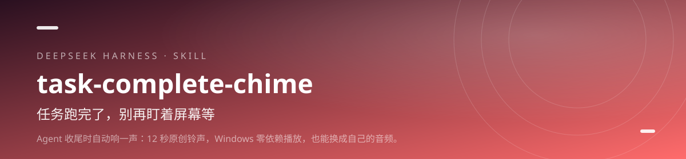

<div align="center">



<h1>task-complete-chime · 任务完成提示音</h1>

<p><b>任务跑完了，别再盯着屏幕等。</b></p>

<p>Agent 收尾时自动响一声：12 秒原创铃声，Windows 零依赖播放，也能换成自己的音频。</p>

[](https://github.com/lilinshuei/task-complete-chime/actions/workflows/validate.yml)
[](LICENSE)
[](https://www.npmjs.com/package/task-complete-chime)
[](https://github.com/topics/dsh-plugin)
[](#环境要求)

</div>

---

## 它解决什么问题

同时挂几个任务时，最浪费注意力的动作是反复切窗口看“好了没有”。眼睛要盯着，手要切回来，结果可能还没好。

这个 Skill 把“完成”变成一声听得见的信号：任务收尾响一次，失败也响，纯问答每轮结束也响。声音一响再去看结果，中间的时间可以专心做别的事。

## 你会得到什么

- **只响一次** — 多步骤任务只在最后收尾响，不会每一步都打断你。
- **成功失败都提醒** — 失败也是一轮结论；听到声音就知道有东西要检查。
- **原创铃声，无版权风险** — 内置 12 秒合成 WAV，不含任何商业歌曲片段。
- **Windows 零依赖** — 只用 Python 标准库 wave + winsound，不需要 pip install。
- **三条停止通道** — --stop、播满时长、Ctrl+C，随时能让它安静。

## 安装

### npm 一行安装（推荐）

```powershell
dsh plugin --profile web add task-complete-chime
```

包已发布到 npm registry，命令最短，也不依赖 GitHub 访问。桌面端把 `web` 换成 `desktop`；装完重启 DSH，新会话即可调用。

### 从 GitHub 安装

```powershell
dsh plugin --profile web add github:lilinshuei/task-complete-chime
```

想跟最新提交，或 npm 拉取不畅时用这条。

### 手动安装

```bash
git clone https://github.com/lilinshuei/task-complete-chime.git
mkdir -p ~/.dsh/skills
cp -r task-complete-chime ~/.dsh/skills/
```

最终路径是 `~/.dsh/skills/task-complete-chime/SKILL.md`。仓库根目录就是 Skill 本体，不用再找子目录。

## 快速上手

### 1. 播默认铃声

```powershell
python scripts/chime.py
```

Windows + Python 3.9+；默认播放 assets/chime.wav。

### 2. 换成自己的音频

```powershell
python scripts/chime.py --audio "C:\path\to\your.wav" --seconds 8
```

WAV 直接播；MP3 / MP4 需要 ffmpeg 在 PATH 中。

### 3. 立刻停止

```powershell
python scripts/chime.py --stop
```

写入停止标记，播放进程约 0.1 秒内停下。

## 能力边界

- 只支持 Windows；winsound 是 Windows 专属接口。
- 它不会自己监听 Agent 事件；需要 Agent 在收尾时调用脚本。
- 不写注册表、不改系统提示音、不删除任何现有文件。
- 换成自己的歌曲时，请自行确认使用权。

## 环境要求

| 项 | 要求 |
|---|---|
| 操作系统 | Windows 10 / 11 |
| 运行时 | Python 3.9+ |
| 第三方包 | 零；只用标准库 |
| 非 WAV 音频 | 需要 ffmpeg 在 PATH 中 |

## 仓库里有什么

```
task-complete-chime/
├── scripts/chime.py
├── assets/chime.wav
├── SKILL.md
├── lib/index.js          # DSH 插件适配层（零依赖）
├── cordis.patch.yml      # DSH 挂载声明
├── tools/                # 仓库自检 + 适配层冒烟测试
└── README.md
```

- scripts/chime.py — 标准库播放器、停止标记、日志
- assets/chime.wav — 12 秒原创铃声（22050Hz 单声道）
- SKILL.md — 触发时机、停止方式、设计边界

## 安全与隐私

- **零遥测**：不上报使用数据、不内置统计、不访问外部接口。
- **本地执行**：所有处理都在你的机器上完成；需要联网时只发生在你自己执行的包管理器或下载命令里。
- **不删文件**：仓库脚本以“只新增、不删除”为约束；需要清理时会先说明并留回退路径。
- **无凭据**：仓库不包含账号、令牌、Cookie 或本机绝对路径。发现问题请按 [SECURITY.md](SECURITY.md) 私下报告。

## 同系列 Skill

| Skill | 一句话 |
|---|---|
| **[novel-atlas](https://github.com/lilinshuei/novel-atlas)** | 把一本小说，变成一座可以走进去的世界。 |
| **[pc-privacy-shield](https://github.com/lilinshuei/pc-privacy-shield)** | 你的屏幕看得见，别人的截屏看不见。 |
| **[blank-workbench](https://github.com/lilinshuei/blank-workbench)** | 一句话，得到一个能直接干活的工作台。 |
| **[phone-media-transfer-android-app](https://github.com/lilinshuei/phone-media-transfer-android-app)** | App 说找不到文件夹？那就从电脑直接送进去。 |
| **[source-to-app](https://github.com/lilinshuei/source-to-app)** | 源码到双击即用，只差这一条命令。 |

## License

MIT © 2026 lilinshuei。本 Skill 为原创设计；第三方依赖与素材在各自目录内单独标注。

---

如果它替你省下了时间，点一个 **Star**，让更多人找到它。
